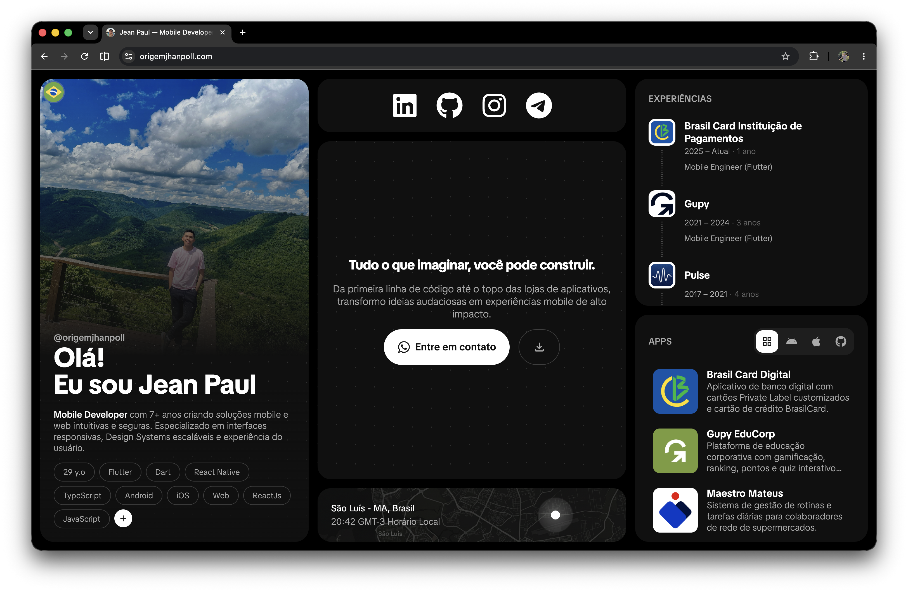
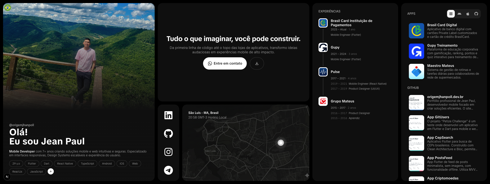
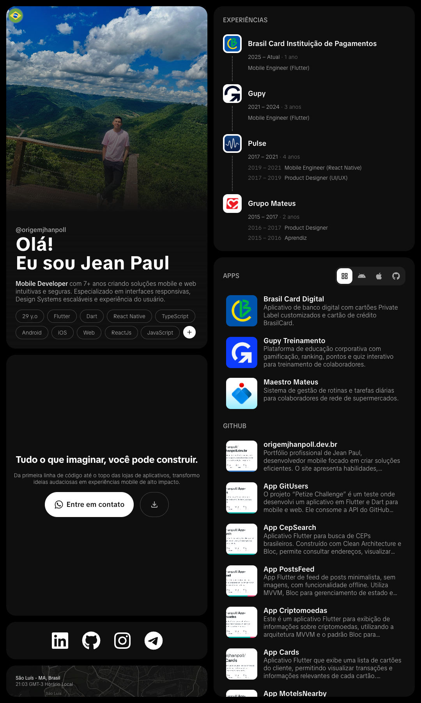

# Portfólio - Jean Paul

<div align="center">

[](https://nextjs.org/)
[](https://react.dev/)
[](https://www.typescriptlang.org/)
[](https://tailwindcss.com/)
[](LICENSE)

<br />

**Portfólio pessoal e profissional desenvolvido com foco em alta performance, interatividade e experiência do usuário.**

[Visualizar Demonstração](https://origemjhanpoll.com.dev) • [Reportar Bug](https://github.com/origemjhanpoll/origemjhanpoll.com.dev/issues) • [Solicitar Recurso](https://github.com/origemjhanpoll/origemjhanpoll/issues)

</div>

---

## 📸 Demonstração

### 🖥️ Visão Desktop Padrão
<div align="center">
  
</div>

<br />

### 🖥️ Visão Responsiva Horizontal (Widescreen)
<div align="center">
  
</div>

<br />

### 📱 Visão Responsiva Vertical (Mobile)
<div align="center">
  
</div>

---

## 📖 Sobre o Projeto

Este projeto é o portfólio pessoal e profissional de **Jean Paul** ([@origemjhanpoll](https://github.com/origemjhanpoll)), Desenvolvedor Mobile & Web.

O objetivo do site é apresentar habilidades, experiências, projetos em produção e canais de contato de forma moderna, intuitiva e totalmente responsiva. Todo o conteúdo é gerenciado dinamicamente através de arquivos JSON desacoplados, permitindo internacionalização nativa e atualizações contínuas sem a necessidade de reescrever componentes ou alterar a regra de negócio.

### ✨ Principais Funcionalidades

- 🌐 **Internacionalização Dinâmica (i18n):** Suporte nativo e troca em tempo real entre **Português (BR)**, **Inglês (US)** e **Mandarim (CN)** alimentado por arquivos JSON estruturados.
- 🎨 **Fundo Geométrico Interativo:** Canvas animado customizado que reage dinamicamente aos movimentos do cursor do usuário.
- 📱 **Totalmente Responsivo:** Layout fluido e adaptado para dispositivos móveis, tablets e telas desktop ultrawide utilizando Tailwind CSS v4.
- 📂 **Galeria e Detalhes de Projetos:** Sistema de filtragem por categoria (Android, iOS, Web/Open Source) e páginas dinâmicas com renderização de Markdown e especificações técnicas.
- 🕒 **Widget de Horário Local:** Componente de fuso horário em tempo real indicando a disponibilidade e localização atual.
- ⚡ **Stack Moderna com Next.js 16:** Renderização híbrida (SSR e Client Components otimizados) com Turbopack e React 19.

---

## 🛠️ Tecnologias Utilizadas

O ecossistema do projeto foi atualizado para as ferramentas mais modernas do ecossistema React/Next.js:

- **[Next.js 16](https://nextjs.org/)** (App Router): Framework React para produção com suporte a Turbopack e renderização híbrida de alta performance.
- **[React 19](https://react.dev/)**: Biblioteca para construção de interfaces de usuário declarativas e reativas.
- **[TypeScript](https://www.typescriptlang.org/)**: Tipagem estática garantindo consistência, previsibilidade e manutenibilidade do código.
- **[Tailwind CSS v4](https://tailwindcss.com/)**: Motor utilitário de estilização moderna com suporte a `@tailwindcss/typography`.
- **[React Icons](https://react-icons.github.io/react-icons/)**: Conjunto abrangente de ícones vetoriais leves.
- **[react-markdown](https://github.com/remarkjs/react-markdown) + [rehype-raw](https://github.com/rehypejs/rehype-raw)**: Parser e renderizador de conteúdo Markdown com suporte a HTML embutido nos detalhes dos projetos.
- **[ESLint](https://eslint.org/)**: Padronização de qualidade e boas práticas de código.

---

## 🚀 Como Executar o Projeto

### Pré-requisitos

Certifique-se de ter instalado em sua máquina:
- [Node.js](https://nodejs.org/) (versão 20.x ou superior recomendada)
- Gerenciador de pacotes `npm`, `pnpm` ou `yarn`

### Passo a Passo

1. **Clone o repositório:**
   ```bash
   git clone https://github.com/origemjhanpoll/origemjhanpoll.com.dev.git
   cd origemjhanpoll.com.dev
   ```

2. **Instale as dependências:**
   ```bash
   npm install
   ```

3. **Inicie o servidor de desenvolvimento:**
   ```bash
   npm run dev
   ```

4. **Acesse no navegador:**
   Abra [http://localhost:3000](http://localhost:3000) para visualizar a aplicação em execução.

### Scripts Disponíveis

| Comando | Descrição |
| :--- | :--- |
| `npm run dev` | Inicia o servidor local de desenvolvimento com hot-reload (Turbopack) |
| `npm run build` | Compila e otimiza o código para o ambiente de produção |
| `npm run start` | Executa o build de produção localmente |
| `npm run lint` | Executa a verificação estática de código com o ESLint |

---

## 📁 Estrutura do Projeto

O código-fonte da aplicação está estruturado dentro da pasta `app/`, seguindo os padrões do App Router do Next.js:

```
origemjhanpoll.com.dev/
├── app/
│   ├── assets/                       # Recursos estáticos e fontes de dados
│   │   ├── fonts/                    # Tipografia customizada (TikTokSans)
│   │   ├── image/                    # Imagens do portfólio (screen.png, widescreen.png, screenvertical.png, local_image.png)
│   │   ├── json/                     # Conteúdo i18n — data.json por idioma (pt, en, cn)
│   │   ├── png/                      # Bandeiras e ícones rasterizados
│   │   └── svg/                      # Badges vetoriais (App Store, Play Store)
│   ├── components/                   # Componentes de interface (UI)
│   │   ├── shared/                   # Componentes atômicos e reutilizáveis
│   │   │   ├── button.tsx            # Botão customizado com variantes
│   │   │   └── markdown-viewer.tsx   # Renderizador de Markdown dos projetos
│   │   ├── actions.tsx               # Controles de ação e alternador de idiomas
│   │   ├── details.tsx               # Seção de detalhes e especificações do projeto
│   │   ├── experience.tsx            # Linha do tempo de experiência profissional
│   │   ├── geometric-background.tsx  # Fundo geométrico dinâmico com Canvas
│   │   ├── local.tsx                 # Widget de horário local e timezone
│   │   ├── main.tsx                  # Seção Hero (apresentação inicial)
│   │   ├── profile.tsx               # Resumo de perfil e matriz de habilidades
│   │   ├── projects.tsx              # Galeria e listagem de projetos
│   │   ├── projects-filter.tsx       # Barra de filtros por categoria
│   │   ├── social.tsx                # Links sociais e badges de redes
│   │   └── index.ts                  # Barrel export dos componentes
│   ├── hooks/                        # Custom React Hooks
│   │   └── use_og_image.ts           # Hook para carregar Open Graph de repositórios
│   ├── projects/                     # Rotas dinâmicas do Next.js
│   │   └── [slug]/
│   │       ├── page.tsx              # Server Component da página de detalhes do projeto
│   │       └── project-client.tsx    # Client Component interativo do projeto
│   ├── services/                     # Camada de abstração e formatação de dados
│   │   ├── experience_service.ts     # Processamento dos dados de experiência
│   │   ├── main_service.ts           # Dados da seção hero
│   │   ├── profile_service.ts        # Dados do perfil e habilidades
│   │   ├── projects_service.ts       # Busca, ordenação e getProjectBySlug
│   │   ├── social_service.ts         # Links de redes e contatos
│   │   └── index.ts                  # Barrel export dos serviços
│   ├── utils/                        # Utilitários gerais
│   │   └── slugify.ts                # Conversor de títulos para slugs de URL amigáveis
│   ├── globals.css                   # Definições globais do Tailwind CSS
│   ├── home.css                      # Estilos específicos da home page
│   ├── home-client.tsx               # Client Component orquestrador da página inicial
│   ├── layout.tsx                    # Root Layout da aplicação Next.js
│   └── page.tsx                      # Entrypoint da página inicial
├── public/                           # Ativos estáticos públicos servidos na raiz
├── next.config.ts                    # Configurações do Next.js
├── tsconfig.json                     # Configurações do TypeScript
└── package.json                      # Dependências e scripts do projeto
```

### 🧱 Detalhamento dos Módulos

- **`📂 components`**: Concentra a interface do usuário dividida de forma modular. Separa componentes de visualização pura, componentes com estado reativo e componentes compartilhados (`shared/`).
- **`📂 services`**: Atua como uma camada DAO (Data Access Object). Desacopla a interface da estrutura bruta dos arquivos JSON, expondo funções tipadas para busca, filtragem e formatação dos dados.
- **`📂 assets/json`**: O núcleo de conteúdo da aplicação. Permite que todo o portfólio seja traduzido e atualizado sem intervenção no código React.
- **`📂 projects/[slug]`**: Rota dinâmica do Next.js App Router para visualização aprofundada de projetos com carregamento de detalhes e suporte a Markdown.

---

## 👨‍💻 Autor

<div align="center">
  
  
  **Jean Paul**  
  *Mobile & Web Developer*

  [](https://www.linkedin.com/in/origemjhanpoll)
  [](https://github.com/origemjhanpoll)
  [](https://instagram.com/origemjhanpoll)
  [](https://t.me/origemjhanpoll)
  [](mailto:origemjhanpoll@gmail.com)
  [](https://wa.me/origemjhanpoll)

</div>

---

## 📄 Licença

Este projeto está sob a licença [MIT](LICENSE) - sinta-se à vontade para utilizá-lo como referência para os seus próprios projetos.

<div align="center">
  Feito com ❤️ por <a href="https://github.com/origemjhanpoll">Jean Paul</a>
</div>
